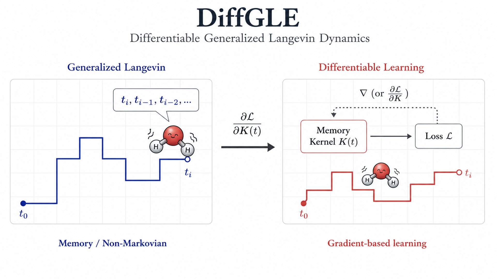
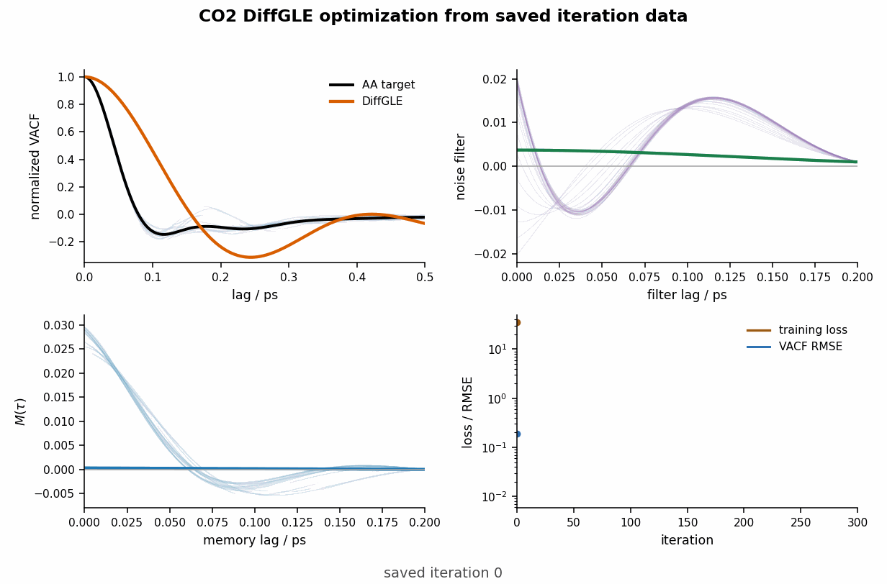
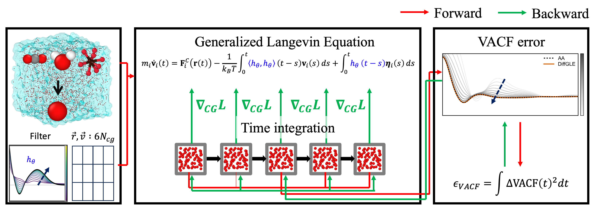

# DiffGLE

**Differentiable generalized Langevin dynamics for coarse-grained models**

[](https://www.python.org/)
[](LICENSE)

<p align="center">
  
</p>

DiffGLE learns the missing non-Markovian part of coarse-grained dynamics while keeping the conservative coarse-grained force fixed. The fluctuating force is represented by a trainable colored-noise filter, and the friction memory is defined from that filter through the fluctuation-dissipation theorem. This makes the stochastic forcing and dissipation consistent by construction while allowing the dynamics to be optimized directly against time-correlation observables such as the velocity autocorrelation function (VACF).

This package provides the necessary reproducibility scripts for the project. It contains the code and compact processed data needed to reproduce the key results for CO2, H2O and a free CG star-polymer bead.


## Optimization Example

The animation below is generated from the saved CO2 optimization history bundled in `paper_data/`. It shows the VACF, learned colored-noise filter, FDT memory kernel, and training loss evolving over saved optimization iterations.

<p align="center">
  
</p>

Regenerate this README animation with:

```bash
python scripts/make_readme_gif.py
```

## Core Idea

<p align="center">
  
</p>

For coarse-grained coordinates \(r\) and velocities \(v\), DiffGLE uses a generalized Langevin dynamics model of the form

```math
m_i \dot v_i(t)
=
F_i^{C}(r(t))
-
\int_0^t \Gamma_\theta(t-s)v_i(s)\,ds
+
R_{i,\theta}(t).
```

The conservative force is fixed. The trainable object is a causal colored-noise filter applied to white noise,

```math
R_{i,\theta}(t)
=
\int_0^\infty h_\theta(u)\eta_i(t-u)\,du.
```

The memory kernel is then the filter autocorrelation,

```math
\Gamma_\theta(\tau)
=
\frac{1}{k_B T}
\int_0^\infty h_\theta(u+\tau)h_\theta(u)\,du.
```

This construction gives an FDT-consistent friction/noise pair for any learned filter. The filter parameters are optimized by differentiating through coarse-grained trajectories and matching reference dynamical observables.

## Repository Contents

| path | contents |
|---|---|
| `main.py`, `force.py`, `utility.py` | differentiable CG/GLE simulation components for the molecular-fluid examples |
| `Data/CO2/`, `Data/H2O/` | compact preprocessed COM initial conditions, reference observables, boxes, and fixed tabulated CG pair potentials |
| `paper_data/` | compact optimization histories, production observables, gradient diagnostics, and supplementary source curves used for the manuscript figures |
| `scripts/` | figure and README-asset reproduction scripts |


## Installation

For reproducing the key results from the bundled compact arrays:

```bash
python -m venv .venv
source .venv/bin/activate
pip install -r requirements-figures.txt
```

For rerunning the differentiable MD demos, install the full dependencies:

```bash
pip install -r requirements.txt
```

Install the PyTorch build appropriate for your machine before full GPU runs if you need a specific CUDA version. 

## Reproduce Manuscript Figures

Generate the main results figure for CO2, H2O, and the star-polymer no-force benchmark:

```bash
python scripts/make_paper_figures.py
```

Generate the CO2 gradient-mechanics diagnostic:

```bash
python scripts/plot_gradient_mechanics.py
```

Generate supplementary FDT-closure and conservative-potential figures:

```bash
python scripts/plot_fdt_closure.py
python scripts/plot_pair_potentials.py
```

Generated figures are written under `figures/generated/`.

## Paper Run Settings

The compact arrays in `paper_data/` are the recommended route for reproducing the plotted manuscript results exactly. The settings are stored next to each saved history.

| system | data | setting summary |
|---|---|---|
| CO2 | [history](paper_data/optimization_histories/co2_symdetach_lr3e5_iter372/) | fixed CO2 CG-CG potential, free colored-noise filter, adjoint-assisted optimization, SGD, selected iteration 372 |
| H2O | [history](paper_data/optimization_histories/h2o_original_fromscratch/) | fixed H2O CG-CG potential, free colored-noise filter, adjoint-assisted optimization, Adam learning-rate schedule, 300 iterations |
| star polymer | [from scratch](paper_data/optimization_histories/star_polymer_noforce_fromscratch_support700/), [continuation](paper_data/optimization_histories/star_polymer_noforce_continuation_support700/) | no conservative force, fixed-noise direct optimization, 64 replicas, 7 particles per replica, long-support free filter |

See `paper_data/optimization_histories/optimization_history_manifest.md` for the full hyperparameter and metric summary.

## Rerun Bulk-Fluid Training Demos

The compact preprocessed data under `Data/` are sufficient for the default H2O and CO2 differentiable MD runs:

```bash
python main.py --system CO2 --device cuda:0 --iterations 300
python main.py --system H2O --device cuda:0 --iterations 300
```

Use `--device cpu` for small smoke tests. CPU training is much slower and is intended only for debugging. Outputs are written to `Result/<system>/`.

## Data Notes

For the molecular fluids, the CG mapping is one center-of-mass bead per molecule. The fixed conservative interactions are tabulated CG-CG pair potentials:

- `Data/CO2/CG/CG_CG.pot`,
- `Data/H2O/CG/CG_CG.pot`.

The force column from each table is interpolated during simulation and is not trained during DiffGLE optimization.

The star-polymer benchmark is stored as compact target curves and learned filter/kernel snapshots in `paper_data/optimization_histories/`. It documents the memory-learning result without requiring exploratory polymer run directories.

## Reference

If you use this code or data, please reference:

J. Jeong and I. Nadkarni "DiffGLE: Differentiable Coarse-Grained Dynamics using Generalized Langevin Equation," arXiv:2410.08424, 2024. https://doi.org/10.48550/arXiv.2410.08424

## License

This project is distributed under the MIT License. See `LICENSE` for details.
